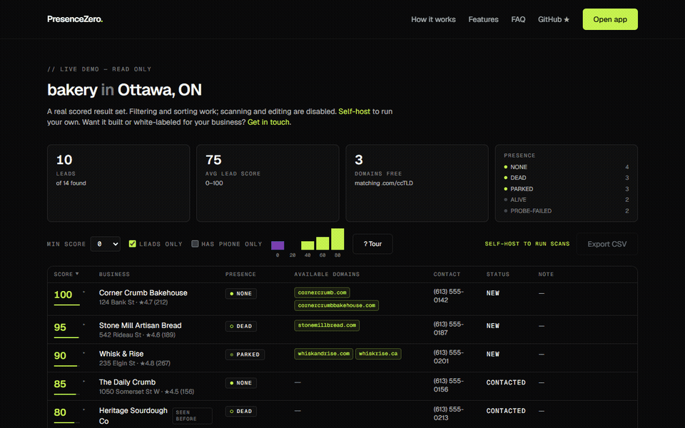
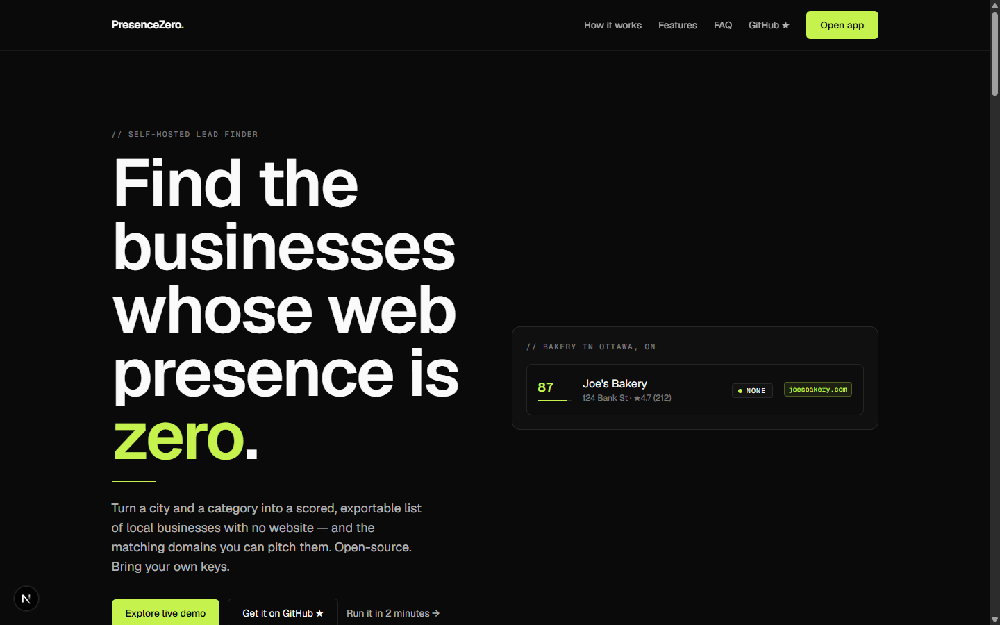

# PresenceZero: find businesses without websites

**Free, open-source lead finder for web designers and agencies.** Turn *"plumbers in Ottawa"* into a scored list of local businesses with **no website, a dead website, or a parked domain**, plus the matching domains you can pitch them.

[](https://github.com/its-tahir/presence-zero/actions/workflows/ci.yml)
[](LICENSE)


**[Live demo](https://presencezero.its-tahir.com/demo)** · **[Website](https://presencezero.its-tahir.com/)** · **[Guides](https://presencezero.its-tahir.com/guides)** · **[Quick start](#quick-start)** · **[Contributing](CONTRIBUTING.md)**

PresenceZero is a self-hosted alternative to paid "businesses without websites" finders and Google Maps lead scrapers. Pick a location and a business category. It pulls matching businesses from OpenStreetMap, Google Places, Apify or your own CSV, then:

- **checks every listed website** and labels it `none`, `dead`, `parked` or `alive`, recording the exact reason ("DNS lookup failed", "Returned HTTP 503", "Matched a registrar for-sale page");
- **checks matching domain availability** (`smithplumbing.com`, plus the country domain) with free [RDAP](https://about.rdap.org/) lookups;
- **scores every lead 0–100** from web presence, reviews, rating, phone number and domain availability;
- hands you a **filterable, exportable lead list** (CSV / JSON).

No account, no API key and no subscription required: OpenStreetMap and CSV work out of the box. It's a lead *finder*, not an outreach or CRM tool.



If this helps you find leads, a ⭐ helps others find the project.

## Who it's for

- **Freelance web designers and developers** looking for web design leads and their next client.
- **Web design, marketing and local SEO agencies** that prospect local businesses.
- **Anyone selling to local businesses** (websites, AI receptionists, booking tools) who wants businesses that are visibly missing online.
- **Domain investors** who want available domains next to real, active businesses.

## Why PresenceZero

| | PresenceZero | Typical hosted lead finder |
|---|---|---|
| Price | Free, MIT licensed | Subscription or per-lead credits |
| Your lead list | Stays on your machine | Stored on the vendor's servers |
| Finds businesses with no website | Yes | Yes |
| Catches **dead** and **parked** websites (with the reason) | Yes | Usually only "website field is empty" |
| Checks if the matching domain is available | Yes, via RDAP | Rarely |
| Data sources | OpenStreetMap, Google Places, Apify, CSV | Usually Google Maps only |
| Bulk email / spam features | None, by design | Often built in |

See the full, dated comparison with Grape Leads, Webleadr, B2BLeadFinder, Webless Leads, Outscraper and Thyonix: **[Tools to find businesses without websites, compared](https://presencezero.its-tahir.com/alternatives)**.



## How it works

1. **Find** — pick a location + category and a data source (Google Places, Apify (Google Maps), OpenStreetMap, or a CSV you already have). PresenceZero pulls the matching businesses.
2. **Probe** — it visits each listed website and labels it `none`, `dead`, `parked`, or `alive`. The first three are your leads.
3. **Check domains** — for each lead it derives likely domain names from the business name and checks availability via [RDAP](https://about.rdap.org/) (no key needed), surfacing the exact-match `.com`/ccTLD if it's free.
4. **Score** — each lead gets a 0–100 opportunity score (no website + real customers + an available domain = a hot lead). The table sorts hottest-first.
5. **Work the list** — filter, sort, and set a lead status or note. Expand any row for a plain-language **score breakdown** (why it scored what it did) and a **ready-to-personalize outreach angle** you can copy — then export to CSV to take into your own workflow.

## Quick start

### Option A — Run it locally (simplest, ~2 minutes)

You only need [Node.js 20+](https://nodejs.org). No database setup, no API key.

```bash
git clone https://github.com/its-tahir/presence-zero.git
cd presence-zero
npm install
npm run dev
```

Open **http://localhost:3000**. It creates a local SQLite file (`presencezero.db`) automatically and works immediately with the **OpenStreetMap** and **CSV** providers — no key required. Want Google Places too? See [Data sources](#data-sources) and [Environment variables](#environment-variables).

### Option B — Docker (self-host)

```bash
docker build -t presencezero .
docker run -v ./data:/data -p 3000:3000 presencezero
```

Open **http://localhost:3000**. The SQLite database lives at `./data/presencezero.db` on the host, so it survives container restarts and upgrades.

### Option C — Vercel + Turso (free hosting)

PresenceZero uses SQLite via [libSQL](https://turso.tech/libsql), so it runs equally well against a local file or a hosted [Turso](https://turso.tech) database — Turso's free tier is generous enough for personal/small-team use.

1. Create a free Turso database (`turso db create presencezero`, or via the Turso dashboard) and grab its `libsql://` URL and an auth token.
2. Deploy this repo to Vercel and set two environment variables (see the table below): `DATABASE_URL` and `DATABASE_AUTH_TOKEN`.
3. Deploy. Migrations run against the Turso database on first request, the same way they do locally.

**Verify the deploy in ~60 seconds:**

1. Open your deployment's **`/demo`** — it's fully static, so if the scored table renders, the app built and shipped correctly.
2. Open **`/app`** and run a small OpenStreetMap scan (e.g. `Ottawa, ON` / `cafe`). If results appear, the Turso database, the startup migrations, and the scan pipeline all work end to end.
3. **If the app 500s on first load, it's almost always migrations.** Confirm `next.config.ts` still has `outputFileTracingIncludes: { "/**": ["./drizzle/**"] }` (this bundles the migration files into the serverless function) and that both `DATABASE_URL` and `DATABASE_AUTH_TOKEN` are set. The thrown error names the exact failing path.

> **No login screen.** PresenceZero ships without auth — anyone with the URL can use it and see your leads. Keep any hosted deployment's URL private until auth lands. See [Known limitations](#known-limitations).

## Environment variables

**All optional.** With none set, PresenceZero runs locally against a SQLite file and works with the OpenStreetMap and CSV providers. Copy [`.env.example`](.env.example) to `.env` to configure:

```bash
cp .env.example .env
```

| Variable | Default | When you need it |
|---|---|---|
| `DATABASE_URL` | `file:presencezero.db` | Set to a Turso `libsql://…` URL for hosted/Vercel deploys. |
| `DATABASE_AUTH_TOKEN` | — | Only for a hosted libSQL/Turso database. |
| `GOOGLE_PLACES_API_KEY` | — | Only for the Google Places provider (you can also paste the key in the app's **Settings** page). |
| `APIFY_TOKEN` | — | Only for the Apify (Google Maps) provider (you can also paste the token in the app's **Settings** page). |
| `APIFY_MAX_PLACES` | `100` | Advanced: raises the per-scan place ceiling for the Apify provider. Each place costs money — see [Data sources](#data-sources). |
| `PRESENCEZERO_BATCH_SIZE` | `8` | Advanced: businesses processed per scan step. Lower for tight serverless time limits; raise when self-hosting. |

## Data sources

**Google Places** — go to the [Google Cloud Console](https://console.cloud.google.com/), create a project, and enable **"Places API (New)"** (the classic Places API will not work — the field mask this app requests is New-API-only). Create an API key restricted to that API and add it under **Settings** in the app, or set it as the `GOOGLE_PLACES_API_KEY` environment variable. Google's free tier covers a meaningful number of monthly searches before billing kicks in.

**Apify (Google Maps)** — the easiest data source to set up: no Google Cloud project, no field-mask tuning, just one API token from [console.apify.com](https://console.apify.com) (Settings → API & Integrations), pasted into the app's **Settings** page or set as `APIFY_TOKEN`. It runs Apify's `compass/crawler-google-places` actor, which costs **$0.004 per scraped place**. Apify's free plan renews **$5 of credit every month, no credit card required**, which is roughly **1,250 places** — about 12 scans of 100 places, or 25 of 50. Scans simply stop when the credit runs out; nothing is charged beyond it.

**OpenStreetMap** — no key required, backed by the public Nominatim (geocoding) and Overpass (data) APIs. 23 categories are supported out of the box: `restaurant`, `cafe`, `bar`, `pub`, `fast_food`, `dentist`, `doctor`, `pharmacy`, `veterinary`, `bakery`, `hairdresser`, `butcher`, `florist`, `car_repair`, `beauty`, `optician`, `clothes`, `jewelry`, `boutique`, `plumber`, `electrician`, `carpenter` and `gym`. Common plurals and synonyms (`dentists`, `salon`, `coffee shop`) resolve automatically. Adding a category is one line in [`src/core/providers/osm-categories.ts`](src/core/providers/osm-categories.ts). Along with CSV import below, this is a fully free, keyless way to run PresenceZero end to end.

**CSV import** — bring your own list. Expected header row:

```
name,address,phone,category,rating,review_count,website
```

Only `name` is required; every other column is optional and left blank if unknown.

## Scoring

Every lead gets a score out of 100, built from weighted signals. Defaults live in [`scoring.config.ts`](scoring.config.ts):

| Signal | Weight |
|---|---|
| No website (`none`) | 40 |
| Dead website | 35 |
| Parked website | 30 |
| Review count (scaled, capped at 50 reviews) | up to 25 |
| Good rating (≥ 4.0) | 10 |
| Exact-match domain available | 15 |
| Has a phone number on file | 10 |

Edit `scoring.config.ts` directly to retune weights for your market — there's no UI for it by design, since it's a one-line config file meant to be forked.

Every lead's score is also **explained per row**: expand a result to see exactly which signals earned which points, plus a deterministic, non-spammy **outreach angle** drafted from that lead's real signals (no site + strong reviews + an available domain) that you can copy and personalize before reaching out.

## Guides

Practical, free playbooks on the PresenceZero site:

- [How to find businesses without websites (4 free methods)](https://presencezero.its-tahir.com/guides/how-to-find-businesses-without-websites): Google Maps, an OpenStreetMap Overpass query, directories, and automation.
- [How to get web design clients](https://presencezero.its-tahir.com/guides/how-to-get-web-design-clients): a local-first playbook for freelancers and agencies.
- [How to sell websites to local businesses](https://presencezero.its-tahir.com/guides/how-to-sell-websites-to-local-businesses): scripts, pricing models and objection handling.
- [Parked domains and dead websites](https://presencezero.its-tahir.com/guides/parked-domains-and-dead-websites): what they mean and how to check them.
- [Check domain availability for free with RDAP](https://presencezero.its-tahir.com/guides/check-domain-availability-rdap): curl and JavaScript examples, no API key.
- [Google Maps leads for free: 4 data sources compared](https://presencezero.its-tahir.com/guides/google-maps-leads-free-data-sources): Places API, Apify, OpenStreetMap and CSV.

## FAQ

**Is there a free tool to find businesses without websites?** Yes, this one. PresenceZero is MIT licensed and runs on your own machine. With OpenStreetMap or a CSV it needs no API key or account at all.

**Can it find businesses without websites on Google Maps?** Yes, through the Google Places API with your own key, or Apify's Google Maps actor with your own account. PresenceZero never proxies or resells data.

**What's the difference between a dead and a parked website?** A dead site doesn't load (DNS failure, connection refused, timeout, HTTP 5xx). A parked site loads a registrar placeholder or a "domain for sale" page. Both are often better leads than "no website", because the owner already paid for a site once.

**Does it send cold emails?** No, and it never will. Find a short list, then reach out yourself, one business at a time.

## Tech stack

Next.js 16 (App Router) · TypeScript (strict) · SQLite via Drizzle ORM + libSQL · Zod · Vitest · Tailwind CSS. The domain engine (`src/core/`) is plain framework-free TypeScript, so providers, probes, scoring, and the scan pipeline run and test independently of the web app.

## Known limitations

- **No built-in auth.** Keep self-hosted and Vercel deployments private — anyone with the URL can use the app and see your leads.
- **Website-probe SSRF is guarded, with a residual caveat.** The presence probe only fetches `http(s)` URLs, follows redirects manually, and DNS-resolves every hop — rejecting private, loopback, link-local, and cloud-metadata (`169.254.169.254`) addresses before making a request. The remaining residual is DNS rebinding (a hostname that resolves to a public IP at validation time and a private one at fetch time); the blast radius stays bounded because the probe only ever reports back `alive`/`dead`/`parked`. Still, don't expose a deployment to untrusted users.
- **Large CSV imports are held in memory for export.** Very large imports (tens of thousands of rows) may use significant memory. The app is intended for realistic local-business-scan sizes, not bulk data processing.

## Ethics

PresenceZero is a lead **finder**, not a spam tool. It has no bulk-email, auto-outreach, or scraping-for-spam features, and none are planned — that's a permanent design decision, not a missing feature. The intended workflow is: find a short list of genuinely underserved local businesses, then reach out yourself, like a human, because you have something worth offering them.

## Contributing

See [CONTRIBUTING.md](CONTRIBUTING.md). Short version: quality gates must pass (`npm test`, `npm run lint`, `npx tsc --noEmit`, `npm run build`); `src/core/` stays framework-free; new providers implement `Provider` and register in `registerBuiltInProviders()`. Mass-outreach features will not be accepted.

## License

MIT — see [LICENSE](LICENSE).
