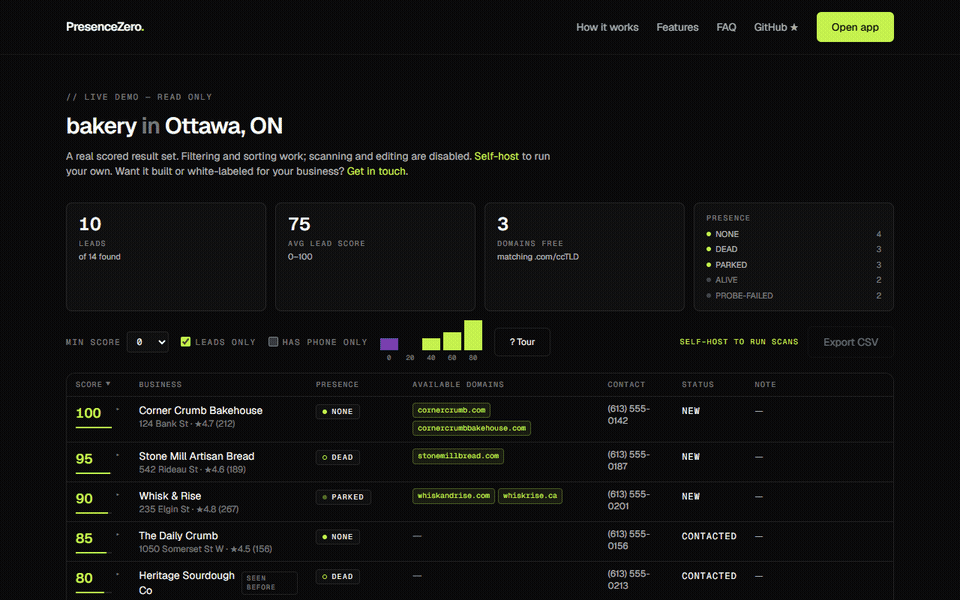
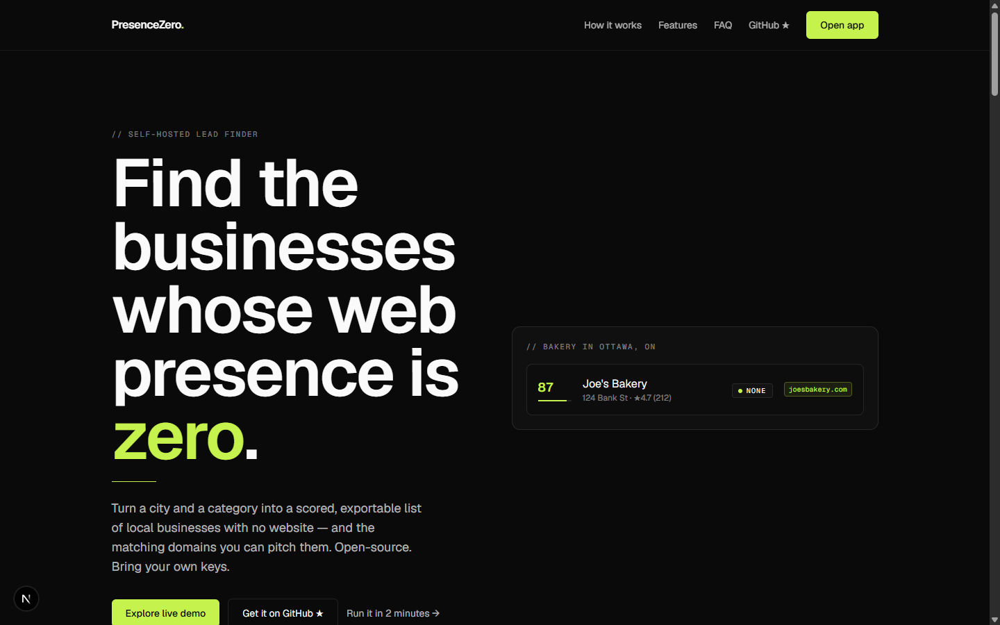

# PresenceZero

**Find local businesses whose web presence is zero — and the domains you can pitch them.**

[](https://github.com/its-tahir/presence-zero/actions/workflows/ci.yml)
[](LICENSE)


**[Live site](https://presencezero.its-tahir.com/)** · **[Live demo](https://presencezero.its-tahir.com/demo)** · **[Quick start](#quick-start)** · **[Contributing](CONTRIBUTING.md)**

PresenceZero is an open-source, self-hosted tool that scans a location and business category, then flags the businesses most likely to need (and buy) a website: the ones with **no site, a dead site, or a domain parked for sale**. For each one it checks whether a **matching domain is still available to register**, scores the opportunity **0–100**, and hands you a filterable, exportable lead list. Bring-your-own-API-key, runs free on Docker or Vercel. It's a lead *finder* — not an outreach or CRM tool.

**Who it's for:** freelance web developers, design/marketing/SEO agencies, and domain investors who want a repeatable way to find underserved local businesses instead of hunting Google Maps by hand.



If this helps you find leads, a star helps others find the project.



## How it works

1. **Find** — pick a location + category and a data source (Google Places, Apify (Google Maps), OpenStreetMap, or a CSV you already have). PresenceZero pulls the matching businesses.
2. **Probe** — it visits each listed website and labels it `none`, `dead`, `parked`, or `alive`. The first three are your leads.
3. **Check domains** — for each lead it derives likely domain names from the business name and checks availability via [RDAP](https://about.rdap.org/) (no key needed), surfacing the exact-match `.com`/ccTLD if it's free.
4. **Score** — each lead gets a 0–100 opportunity score (no website + real customers + an available domain = a hot lead). The table sorts hottest-first.
5. **Work the list** — filter, sort, and set a lead status or note. Expand any row for a plain-language **score breakdown** (why it scored what it did) and a **ready-to-personalize outreach angle** you can copy — then export to CSV to take into your own workflow.

## Quick start

### Option A — Run it locally (simplest, ~2 minutes)

You only need [Node.js 20+](https://nodejs.org). No database setup, no API key.

```bash
git clone https://github.com/its-tahir/presence-zero.git
cd presence-zero
npm install
npm run dev
```

Open **http://localhost:3000**. It creates a local SQLite file (`presencezero.db`) automatically and works immediately with the **OpenStreetMap** and **CSV** providers — no key required. Want Google Places too? See [Data sources](#data-sources) and [Environment variables](#environment-variables).

### Option B — Docker (self-host)

```bash
docker build -t presencezero .
docker run -v ./data:/data -p 3000:3000 presencezero
```

Open **http://localhost:3000**. The SQLite database lives at `./data/presencezero.db` on the host, so it survives container restarts and upgrades.

### Option C — Vercel + Turso (free hosting)

PresenceZero uses SQLite via [libSQL](https://turso.tech/libsql), so it runs equally well against a local file or a hosted [Turso](https://turso.tech) database — Turso's free tier is generous enough for personal/small-team use.

1. Create a free Turso database (`turso db create presencezero`, or via the Turso dashboard) and grab its `libsql://` URL and an auth token.
2. Deploy this repo to Vercel and set two environment variables (see the table below): `DATABASE_URL` and `DATABASE_AUTH_TOKEN`.
3. Deploy. Migrations run against the Turso database on first request, the same way they do locally.

**Verify the deploy in ~60 seconds:**

1. Open your deployment's **`/demo`** — it's fully static, so if the scored table renders, the app built and shipped correctly.
2. Open **`/app`** and run a small OpenStreetMap scan (e.g. `Ottawa, ON` / `cafe`). If results appear, the Turso database, the startup migrations, and the scan pipeline all work end to end.
3. **If the app 500s on first load, it's almost always migrations.** Confirm `next.config.ts` still has `outputFileTracingIncludes: { "/**": ["./drizzle/**"] }` (this bundles the migration files into the serverless function) and that both `DATABASE_URL` and `DATABASE_AUTH_TOKEN` are set. The thrown error names the exact failing path.

> **No login screen.** PresenceZero ships without auth — anyone with the URL can use it and see your leads. Keep any hosted deployment's URL private until auth lands. See [Known limitations](#known-limitations).

## Environment variables

**All optional.** With none set, PresenceZero runs locally against a SQLite file and works with the OpenStreetMap and CSV providers. Copy [`.env.example`](.env.example) to `.env` to configure:

```bash
cp .env.example .env
```

| Variable | Default | When you need it |
|---|---|---|
| `DATABASE_URL` | `file:presencezero.db` | Set to a Turso `libsql://…` URL for hosted/Vercel deploys. |
| `DATABASE_AUTH_TOKEN` | — | Only for a hosted libSQL/Turso database. |
| `GOOGLE_PLACES_API_KEY` | — | Only for the Google Places provider (you can also paste the key in the app's **Settings** page). |
| `APIFY_TOKEN` | — | Only for the Apify (Google Maps) provider (you can also paste the token in the app's **Settings** page). |
| `APIFY_MAX_PLACES` | `100` | Advanced: raises the per-scan place ceiling for the Apify provider. Each place costs money — see [Data sources](#data-sources). |
| `PRESENCEZERO_BATCH_SIZE` | `8` | Advanced: businesses processed per scan step. Lower for tight serverless time limits; raise when self-hosting. |

## Data sources

**Google Places** — go to the [Google Cloud Console](https://console.cloud.google.com/), create a project, and enable **"Places API (New)"** (the classic Places API will not work — the field mask this app requests is New-API-only). Create an API key restricted to that API and add it under **Settings** in the app, or set it as the `GOOGLE_PLACES_API_KEY` environment variable. Google's free tier covers a meaningful number of monthly searches before billing kicks in.

**Apify (Google Maps)** — the easiest data source to set up: no Google Cloud project, no field-mask tuning, just one API token from [console.apify.com](https://console.apify.com) (Settings → API & Integrations), pasted into the app's **Settings** page or set as `APIFY_TOKEN`. It runs Apify's `compass/crawler-google-places` actor, which costs **$0.004 per scraped place**. Apify's free plan renews **$5 of credit every month, no credit card required**, which is roughly **1,250 places** — about 12 scans of 100 places, or 25 of 50. Scans simply stop when the credit runs out; nothing is charged beyond it.

**OpenStreetMap** — no key required, backed by the public Nominatim (geocoding) and Overpass (data) APIs. Currently supported categories: `restaurant`, `cafe`, `bar`, `dentist`, `bakery`, `hairdresser`, `butcher`, `florist`, `plumber`, `electrician`, `carpenter`. More can be added by extending the tag map in `src/core/providers/osm.ts`. Along with CSV import below, this remains a fully free, keyless way to run PresenceZero end to end.

**CSV import** — bring your own list. Expected header row:

```
name,address,phone,category,rating,review_count,website
```

Only `name` is required; every other column is optional and left blank if unknown.

## Scoring

Every lead gets a score out of 100, built from weighted signals. Defaults live in [`scoring.config.ts`](scoring.config.ts):

| Signal | Weight |
|---|---|
| No website (`none`) | 40 |
| Dead website | 35 |
| Parked website | 30 |
| Review count (scaled, capped at 50 reviews) | up to 25 |
| Good rating (≥ 4.0) | 10 |
| Exact-match domain available | 15 |
| Has a phone number on file | 10 |

Edit `scoring.config.ts` directly to retune weights for your market — there's no UI for it by design, since it's a one-line config file meant to be forked.

Every lead's score is also **explained per row**: expand a result to see exactly which signals earned which points, plus a deterministic, non-spammy **outreach angle** drafted from that lead's real signals (no site + strong reviews + an available domain) that you can copy and personalize before reaching out.

## Tech stack

Next.js 16 (App Router) · TypeScript (strict) · SQLite via Drizzle ORM + libSQL · Zod · Vitest · Tailwind CSS. The domain engine (`src/core/`) is plain framework-free TypeScript, so providers, probes, scoring, and the scan pipeline run and test independently of the web app.

## Known limitations

- **No built-in auth.** Keep self-hosted and Vercel deployments private — anyone with the URL can use the app and see your leads.
- **Website-probe SSRF is guarded, with a residual caveat.** The presence probe only fetches `http(s)` URLs, follows redirects manually, and DNS-resolves every hop — rejecting private, loopback, link-local, and cloud-metadata (`169.254.169.254`) addresses before making a request. The remaining residual is DNS rebinding (a hostname that resolves to a public IP at validation time and a private one at fetch time); the blast radius stays bounded because the probe only ever reports back `alive`/`dead`/`parked`. Still, don't expose a deployment to untrusted users.
- **Large CSV imports are held in memory for export.** Very large imports (tens of thousands of rows) may use significant memory. The app is intended for realistic local-business-scan sizes, not bulk data processing.

## Ethics

PresenceZero is a lead **finder**, not a spam tool. It has no bulk-email, auto-outreach, or scraping-for-spam features, and none are planned — that's a permanent design decision, not a missing feature. The intended workflow is: find a short list of genuinely underserved local businesses, then reach out yourself, like a human, because you have something worth offering them.

## Contributing

See [CONTRIBUTING.md](CONTRIBUTING.md). Short version: quality gates must pass (`npm test`, `npm run lint`, `npx tsc --noEmit`, `npm run build`); `src/core/` stays framework-free; new providers implement `Provider` and register in `registerBuiltInProviders()`. Mass-outreach features will not be accepted.

## License

MIT — see [LICENSE](LICENSE).


### Optional automatic website discovery

New scans default to **Charleroi, Belgique** (`be`). Set
`PRESENCEZERO_DEFAULT_LOCATION` and `PRESENCEZERO_DEFAULT_COUNTRY_CODE` in `.env`
to change the initial form values. Restart the app after changing the environment
(or recreate the app container); no image rebuild is needed for these settings.
A missing website in OSM or
Google Places means **unverified**, not confirmed absence of a website.

Add a **Brave Search API** key in Settings or set `BRAVE_SEARCH_API_KEY` to enable
complementary searches for businesses with no listed website. Powered by
[Brave Search API](https://brave.com/search/api/), using your own account. Set your
Brave spending limit to stay within your free credits. Each eligible business
uses one search request with its name and address (8-second request timeout).
No search is made for a business that already has a website or lacks an address.

Discovery conservatively requires a branded hostname, matching business name,
and street/building number/locality evidence in the search snippets. Multiple
matching hostnames, missing evidence, directories, and search failures remain
unverified. This heuristic can miss legitimate sites; it is not proof of ownership
or of absence. A selected site passes through the existing SSRF-protected probe
and scoring pipeline. Its discovery source is recorded in the presence tooltip.
Live sites score zero and disappear from the leads-only view.

Completed scans are snapshots: use **Rerun** after enabling discovery to create a
fresh scan. Automated tests use synthetic search fixtures and never the network.

### PresenceZero + SearXNG with Docker

SearXNG provides complementary website search without a paid search API key.
It uses upstream search engines, which may rate-limit requests or return incomplete
results. Missing or ambiguous matches remain **UNVERIFIED**. SearXNG takes priority
when `SEARXNG_URL` is set; failures never trigger an automatic fallback to Brave.

**Run everything in Docker** (Docker Desktop / Docker Engine must be running):

```bash
npm run docker:up
```

Open PresenceZero at http://localhost:3000 and SearXNG at http://localhost:8080.
Both ports bind only to localhost. The launcher creates a random SearXNG secret in
`.env.docker` with restricted permissions, preserves it on later runs, and builds
the app. This file is ignored by Git and excluded from Docker build context.
You can set `PRESENCEZERO_PORT=3001` or `SEARXNG_PORT=8081` in `.env.docker` if needed.
Compose passes optional settings from `.env` to the app, but overrides its database
path and SearXNG address for the container network.

Docker uses a **separate persistent database** in the `presencezero-data` volume.
Your existing local `presencezero.db` and scans are untouched. Configure your Google
or Apify keys in the Docker app if needed; OSM needs no key. Do not use `down -v`
unless you intend to delete Docker's saved data.

**Keep your existing local app and scans**, running only SearXNG in Docker:

```bash
npm run docker:search
```

Add this to your existing `.env` (adjust the port if you changed it), then restart
`npm run dev`:

```dotenv
SEARXNG_URL=http://127.0.0.1:8080
```

Settings shows **SearXNG enabled**. Re-run a completed scan to use the new search.
The search API accepts JSON because `docker/searxng/settings.yml` enables it.
The website probe retains its existing protection against private/internal URLs;
only the operator-configured search service may be local.

**Operations**:

```bash
# Stop both services, preserving data
npm run docker:down
# SearXNG logs
docker compose --env-file .env.docker logs --tail=100 searxng
# After changing SearXNG settings
docker compose --env-file .env.docker restart searxng
# Check configuration without displaying secrets
node scripts/docker.mjs config
```

The Compose file follows the official SearXNG image's `latest` channel. To update it,
run `docker compose --env-file .env.docker pull searxng`, then `npm run docker:up`
(or `npm run docker:search` for local development).
